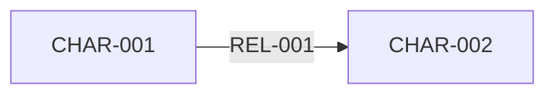

# 关系边与关系回路

## 关系边表

| REL-ID | A | B | 表面关系 | 真实交换 | 权力差 | 信息差 | 情感张力 | 未清债务 | 共同目标 | 根本冲突 | 破裂触发 | 修复条件 | 终局 |
|---|---|---|---|---|---|---|---|---|---|---|---|---|---|
| REL-001 | CHAR-001 | CHAR-002 |  |  |  |  |  |  |  |  |  |  |  |

## 关系状态变化

| REL-ID | 建立事件 | 信用证明 | 权力反转 | 破裂 | 重新定义 | 结算 |
|---|---|---|---|---|---|---|
| REL-001 |  |  |  |  |  |  |

## 关系回路

### LOOP-001｜<回路名>

- A 欠 B：
- B 依赖 C：
- C 掌握 A：
- 当前平衡：
- 外部压力：
- 首个断裂点：
- 对主线影响：

## 主角中心化检查

| 角色 | 非主角关系数 | 主角缺席仍推进的计划 | 是否合格 |
|---|---:|---|---|
| CHAR-002 |  |  |  |

## Mermaid 快图

